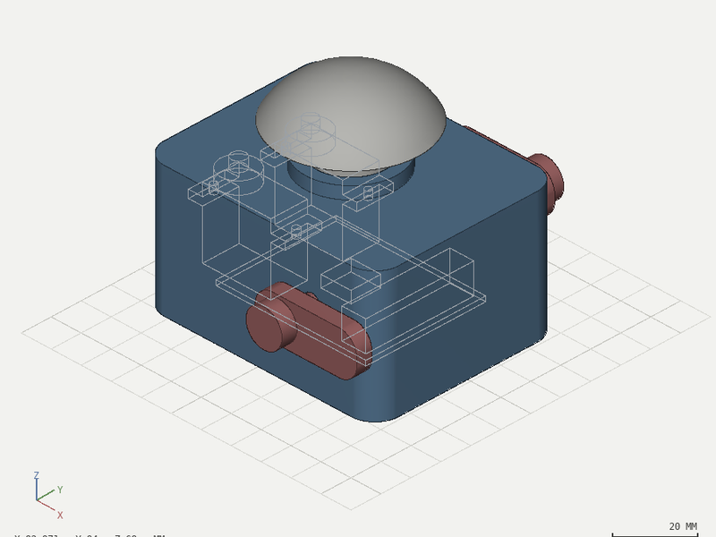
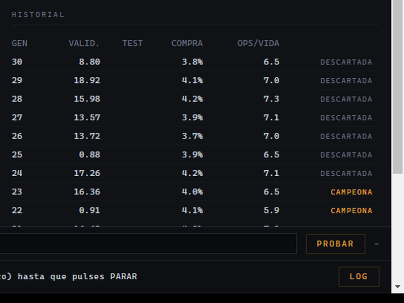
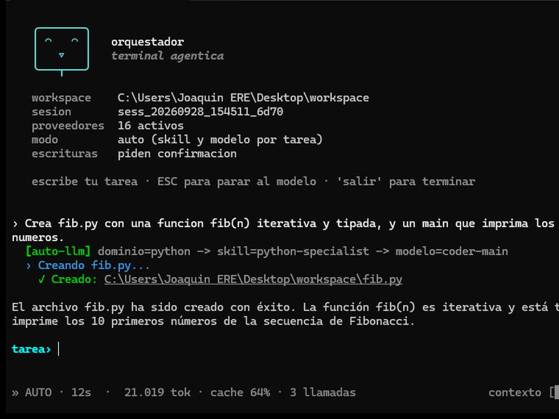

### Joaquín Escrivá de Romaní

Computer Science & Engineering student at **Universidad Carlos III de Madrid**, and former
**Cybersecurity R&D intern at cyan Digital Security** (Vienna, 2026).

I build complete software by directing AI coding agents (Claude Code, Codex, Kimi CLI, Cursor).
I write the spec, split the work into phases, review the code, and demand tests that prove it
works. AI co-authorship is recorded in the commits.

[LinkedIn](https://linkedin.com/in/joaquin-escriva) · Madrid, Spain · Spanish (native), English (C1 Advanced)

---

#### Selected projects

| Project | What it is | Evidence |
|---|---|---|
| [**PC-Control**](https://github.com/VortexJer/PC-Control) | MCP server that lets Claude see and operate Windows apps without stealing focus or moving your mouse. Reads each window the cheapest way (UI Automation text, OCR or image) and writes into Word and Excel via COM without touching your selection. | On PyPI as `claude-pc-control` · 26 stars · re-verifies the window and element right before every action (closes TOCTOU races) |
| [**AISight**](https://github.com/VortexJer/AISight) | Five CLIs that let an AI agent *measure* what a human would *look at*: 3D CAD, PCB layouts, animation, UVs/textures and materials. Deterministic reports with a location and a fix for every finding. | 6 packages on PyPI, published via OIDC (no stored tokens) · CI matrix Ubuntu/Windows/macOS · 272 tests · 26 stars |
| [**NovaChat**](https://github.com/VortexJer/NovaChat-AI) | Self-built AI chat client with no agent framework: own streaming tool loop, hand-written MCP client, `.docx`/`.pptx`/`.xlsx` generation. | Passwords with scrypt, third-party keys encrypted with AES-256-GCM · Docker → GHCR → Render |
| [**Orquestador**](https://github.com/VortexJer/orquestador) | CLI version of NovaChat: FastAPI gateway that routes each task to one of 21 domains and fails over across 23 LLM providers. | 1,097 tests · router accuracy measured on an eval set and enforced as a CI gate |
| [**ECONOSIM**](https://github.com/VortexJer/ECONOSIM) | Economic sandbox to test whether an AI can earn its own living: a fake internet of real-API twins charging real prices, real market data with the era masked, and an Electron panel to watch it all. | Append-only SQLite ledger · agents trained with evolution strategies and chaotic walk-forward validation · live mode where real data comes in and no action goes out |
| [**goldentokens**](https://github.com/VortexJer/Goldentoken) | Token-saving CLIs and Claude Code hooks, based on an audit of real agent sessions (~88 % of tokens went to reading images). | Risk-tiered installer |
| [**ShieldX**](https://github.com/VortexJer/ShieldX) | Manifest V3 ad, tracker and cookie-banner blocker for Chrome. | 360+ `declarativeNetRequest` rules |

<table>
  <tr>
    <td colspan="3"> <b>PC-Control</b> · Claude using Word while you keep your mouse</td>
  </tr>
  <tr>
    <td width="33%"> <b>AISight</b> · a robot modelled and verified by an AI agent</td>
    <td width="33%"> <b>ECONOSIM</b> · generations and champions</td>
    <td width="33%"> <b>Orquestador</b> · routing a task to a specialist</td>
  </tr>
</table>

#### Toolbox

**Security:** VirusTotal, urlscan.io, OSINT, code review, input validation 
**Languages:** Python, SQL, C, R, assembly · TypeScript (reading) 
**Stack:** FastAPI, Next.js, React, Electron, PostgreSQL, Qdrant, Docker, GitHub Actions, pytest, Vitest 
**Systems:** Linux, macOS, Windows, Cisco networking

#### Certifications

Cambridge C1 Advanced · Cisco Networking Basics · Cisco Linux Unhatched · Google Technical Support Fundamentals · C Programming (Alison)
